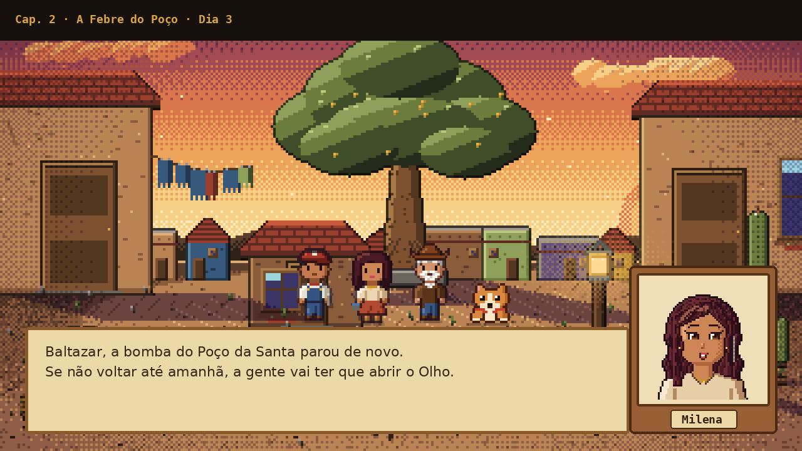

# Colapso 2071

RPG de escolhas em pixel art, ambientado no sertão em 2071. Você chega a Bom-Jardim, um povoado de 412 pessoas que
resiste à seca, e cada decisão muda a água, a comida, a reputação e o destino de todos. Dez capítulos, quatro finais.

## Baixar e jogar

Na página **[Releases](../../releases)** estão os instaladores, com o Java já incluído:

- **Linux (Ubuntu, Mint, Debian):** `colapso2071_*.deb` (dois cliques para instalar) ou a versão portátil `.tar.gz`
- **Windows:** instalador `.exe` ou a versão portátil `.zip`
- **macOS:** `.dmg`

## Rodar pelo código

Precisa de JDK 21 e Maven:

    mvn clean javafx:run

No IntelliJ, também dá para rodar a classe `br.colapso2071.fx.Lancador`. Há ainda uma versão de console
(`br.colapso2071.Main`).

Todo o projeto é em Java: o jogo, o visual das telas (`fx/Estilo`), os testes, os saves (JSON lido e escrito por
`persistencia/Json`) e o gerador de instaladores (`Empacotar.java`).

## Documentação

- [Como executar](docs/COMO_EXECUTAR.md) e [como gerar os instaladores](docs/DISTRIBUIR.md)
- [Arquitetura](docs/ARQUITETURA.md) e [padrões de projeto](docs/PADROES_GOF.md)
- [Sinopse](docs/SINOPSE.md)

Projeto da disciplina EXA863 (2026.2). Arte, música e textos feitos para o jogo.
